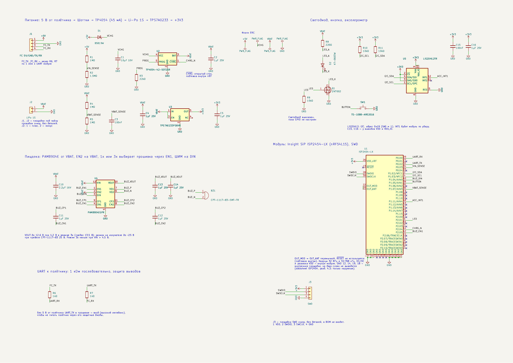
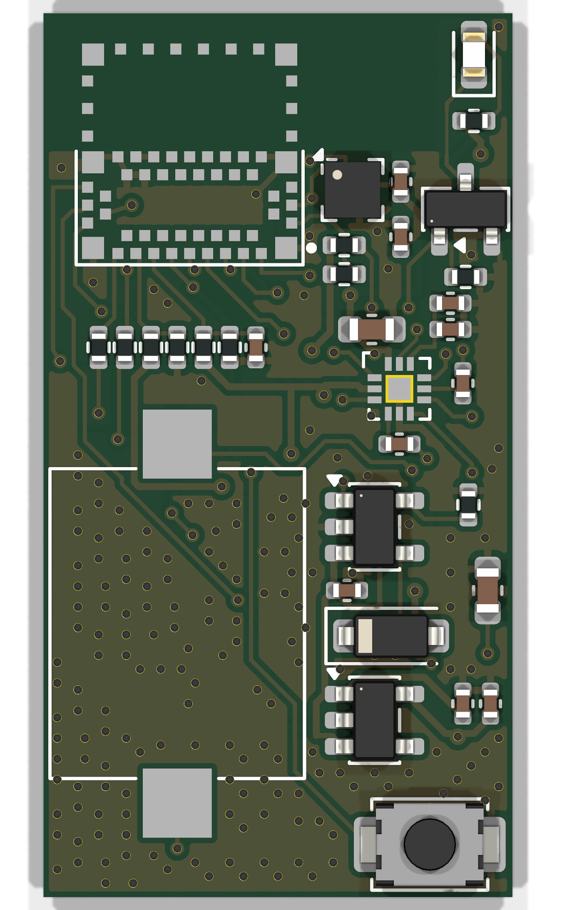
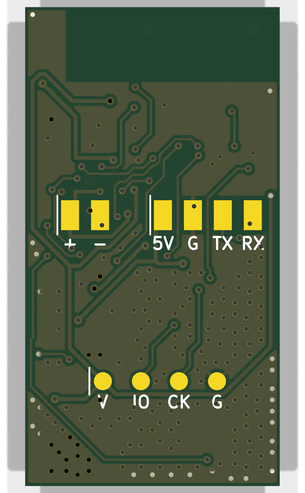
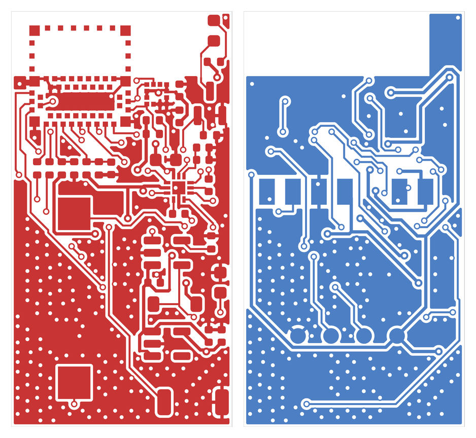

# Cricket

Лёгкий BLE-маячок для поиска упавшего FPV-дрона (`cricket-tag`), своё приложение для поиска и, на следующем этапе, приёмник для поискового дрона (`cricket-seeker`).

Маячок спроектирован с нуля на модуле Insight SiP ISP2454-LX (Nordic nRF54L15, D-29). Схема и плата готовы, прошивка и приложение написаны и собираются; платы ещё не заказаны, поэтому на железе ничего не проверено.

## Что умеет cricket-tag

- Ставится на дроны от BetaFPV Pavo Pico II (80 мм) и крупнее, весит около 3 г с аккумулятором.
- Заряжается от 5 В полётника, после падения работает от своего Li-Po: бипер часами, BLE по расчёту 3,5–6,5 недели (ток ещё не измерен).
- Сам отличает падение от замены аккумулятора: статус armed по MSP, удар по акселерометру, нарастающая тревога. Тревогу поднимает и аварийный конец полёта при живых 5 В: failsafe, дизарм в воздухе, перезагрузка полётника, потеря связи с пультом (D-35, D-36).
- Пищит с тумблера BEEPER в Betaflight и по команде из приложения; пока маячок в тревоге, команду «пищи» принимает и чужой телефон — помощник может найти дрон по звуку.
- Виден своему приложению на сотни метров: Coded PHY, ориентир 300–500 м при прямой видимости, на 1M — 150–250 м (D-17). В рекламе — последние координаты GPS полётника и их возраст.
- Молчит в эфире, пока дрон armed, чтобы не мешать ELRS 2,4 ГГц (D-37).
- Громкий бипер уровня Flywoo Finder V1.0 и белый светодиод.
- Обновляется по BLE (MCUboot, подписанные образы), управляется только привязанным телефоном.
- Собирается на заводе целиком, руками только прошивка и пайка проводов аккумулятора и полётника к площадкам (D-26).

Сети Apple Find My и Google Find Hub — следующий этап после своего механизма поиска (D-32, D-33), сейчас их нет ни в прошивке, ни в приложении.

## Схема и плата

Ревизия A: 17 × 32 мм, 2 слоя, 0,6 мм, все детали сверху. Подробности — в [hardware/cricket-tag/README.md](hardware/cricket-tag/README.md).

  
  
  

Слева направо: верх, низ с площадками проводов и SWD, медь обоих слоёв. Модуль ISP2454-LX (вверху слева, у антенны) и излучатель (большой прямоугольник внизу) на рендере не показаны: у них нет 3D-моделей, видны только площадки.

## Документация

| Документ | Содержание |
|---|---|
| [docs/requirements.md](docs/requirements.md) | требования |
| [docs/decisions.md](docs/decisions.md) | журнал решений с причинами (D-1…D-41) |
| [docs/concept.md](docs/concept.md) | архитектура, режимы, признаки падения, радио, энергобюджет |
| [docs/protocol.md](docs/protocol.md) | реклама Cricket, интервалы по режимам, сервис GATT, команды, привязка |
| [docs/components.md](docs/components.md) | компоненты, коды LCSC, номиналы, требования к антенне, масса |
| [docs/manufacturing.md](docs/manufacturing.md) | заводская сборка, варианты заводов, порядок заказа |
| [docs/cost.md](docs/cost.md) | себестоимость: расчёты заводов и оценка по тиражам |
| [docs/module-options.md](docs/module-options.md) | радиомодули со склада JLCPCB и голый nRF54L10 (отклонены) |
| [docs/app.md](docs/app.md) | своё приложение, сети Find My и Find Hub |
| [docs/setup.md](docs/setup.md) | окружение разработки |

## Состав репозитория

| Папка | Назначение | Статус |
|---|---|---|
| [`hardware/cricket-tag/`](hardware/cricket-tag/README.md) | KiCad-проект маячка | схема ревизии A (ERC 0) и плата 17 × 32 мм (DRC 0) готовы и прошли ревью (D-40, D-41); выходные файлы для завода — в `fab/` |
| [`hardware/cricket-seeker/`](hardware/cricket-seeker/README.md) | приёмник для поискового дрона | не начат |
| [`firmware/`](firmware/README.md) | своя прошивка под MIT, Zephyr / nRF Connect SDK v3.4.2 | свой механизм поиска написан, собирается под плату и nRF54L15 DK; на железе не запускалась |
| [`app/`](app/README.md) | приложение на Flutter: Android и iOS | сканер, «тепло-холодно», карта с пеленгом, офлайн-карты, привязка и настройки есть; с настоящим маячком не проверено |
| `docs/` | документация | актуальна |

## Статус

На 2026-11-12.

**Плата.** Схема и плата ревизии A готовы: ERC 0, DRC со сверкой со схемой 0, разводка убрана и проверена (D-40, D-41). Gerber, BOM и CPL делает `hardware/cricket-tag/make_fab.sh`.

**Заказ.** Завод для первого заказа не выбран (D-31), ничего не оплачено. Рекомендованная нулевая партия — 3–4 платы. Расчёты, прошедшие проверку заводов:

| Завод | Партия | К оплате |
|---|---|---|
| SCSPCBA | 4 платы | 159,83 $ |
| NextPCB | 8 плат | 371 $ |
| Seeed Fusion | 8 плат | 520,70 $ (~470 $ с купоном) |

JLCPCB (~250–285 $ за 8 плат) скрывает сборку для Казахстана и делает панели только с V-cut, который плате не подходит. В серии оценка ~20–22 $ за плату при 24 шт. и ~15–17 $ при 120 шт. Подробности — [docs/manufacturing.md](docs/manufacturing.md#варианты-заводов) и [docs/cost.md](docs/cost.md).

**Прошивка.** Наборы рекламы Cricket Coded и 1M, сервис GATT, режимы, бипер, кнопка, клиент MSP, удар по LIS2DH12, привязка, настройки Bluetooth из приложения, MCUboot с обновлением по BLE, сторожевой таймер, сборка с низким потреблением. Не сделано: замер тока, шлюз Bluetooth → MSP для Betaflight Configurator, наборы Apple и Google ([firmware/README.md](firmware/README.md#не-сделано)).

**Приложение.** Свой BLE-слой на Kotlin и Swift, всё работает без сети. Не сделано: обновление прошивки по BLE, фоновое сканирование, сети Find My и Find Hub, подпись сборок ([app/README.md](app/README.md#не-сделано)).

**Дальше:** выбрать завод и заказать платы, проверить прошивку на nRF54L15 DK, затем на плате вместе с приложением, измерить ток.

## Лицензия

[MIT](LICENSE): схема, плата, скрипты, прошивка, приложение и документация.
